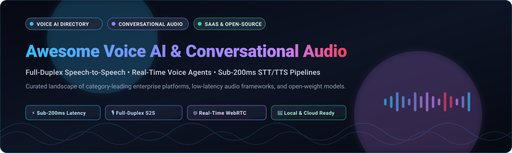

# 🎙️ Awesome Voice AI & Conversational Audio 🎧

  

  
  
  
  
  
  

---

## 🌟 Top Voice AI & Conversational Audio Ecosystem 🚀

**Curated Catalog of SaaS Products & High-Performance Open-Source Projects**  
*Comprehensive developer guide to Real-Time Conversational Voice Agents, Full-Duplex Speech-to-Speech (S2S) Models, Low-Latency ASR/STT & Neural TTS Pipelines, WebRTC Voice Orchestration, Voice Activity Detection (VAD), and System-Wide AI Voice Input Tools.*

**Last updated:** November 2026

---

## 📑 Table of Contents 🧭

- [📊 Sector Overview & Market Dynamics](#-sector-overview--market-dynamics)
- [🏢 SaaS & Hosted Platforms](#-saashosted-platforms)
- [💻 Open-Source GitHub Projects](#-open-source-github-projects)
- [📈 Star History](#-star-history)
- [🤝 How to Contribute](#-how-to-contribute)
- [💖 Support & Sponsorship](#-support--sponsorship)
- [⚖️ Disclaimer](#-disclaimer)

---

## 📊 Sector Overview & Market Dynamics 📈

The global Conversational AI and Voice AI market is expanding rapidly, projected to grow from **$14.3B–$19.2B in 2025** to **$17.1B–$23.8B in 2026**, on track to exceed **$80B by the early 2030s** at an accelerating **~21%–24% CAGR** (with autonomous voice agent niches climbing at ~39% CAGR). 

The sector is **highly fragmented**: rather than a winner-take-all monopoly, the landscape is partitioned across cloud hyper-scalers delivering core infrastructure (AWS, Microsoft, Google), specialized low-latency voice AI innovators (ElevenLabs, Deepgram, Cartesia, Retell AI, Vapi), and a rapidly accelerating open-source ecosystem that enables enterprises to self-host custom on-premise voice stacks.

---

## 🏢 SaaS/Hosted Platforms ☁️

The table below lists the premier SaaS and hosted voice AI platforms, including entry pricing, exact free tier allowances, and corporate valuation/revenue standing (sorted descending by corporate scale):

| Platform | Core Capabilities | Starting Tier Pricing | Free Tier / Free Trial Limits | Company Scale (Valuation / Revenue) |
| :--- | :--- | :--- | :--- | :--- |
| **[Amazon Polly & Transcribe](https://aws.amazon.com/polly/)** | Cloud speech synthesis (Standard, Neural, Generative) & streaming real-time transcription across AWS services. | Standard: $4.00 / 1M chars; Neural: $16.00 / 1M chars; Generative: $30.00 / 1M chars; Transcribe: $0.024 / min | **AWS Free Tier (12 months):** 5M standard chars/month, 1M neural chars/month, 100K generative chars/month; Transcribe: 60 mins/month free for 12 months | **AWS Division of Amazon:** ~$184B Annualized Run Rate (Q3 2024 AWS Net Sales: $27.5B+) |
| **[ElevenLabs Conversational AI](https://elevenlabs.io)** | Flash/Turbo ultra-low-latency TTS, real-time conversational voice agents, and instant voice cloning. | **Starter Plan:** $5.00 / month ($6.00 regular; $5/mo first month promotional rate for 30,000 characters) | **Free Forever:** 10,000 credits/month (~10 mins audio), 3 custom voices, shared voice library, non-commercial use | **Valuation: $22.0 Billion** (Secondary round 2025; ~$600M ARR) |
| **[Deepgram (Nova-3 & Aura)](https://deepgram.com)** | Real-time low-latency ASR, Aura TTS, and turnkey Voice Agent API for WebSockets and telephony. | **Pay-As-You-Go:** Nova-3 pre-recorded ASR: $0.0043 / min; Streaming ASR: $0.0059 / min; Aura-2 TTS: $0.015 / 1K chars | **Free Credit Plan:** $200 one-time credit upon signup with no expiration, full API access, no credit card required upfront | **Valuation: $1.3 Billion** (Series C unicorn; ~$100M ARR) |
| **[Vapi](https://vapi.ai)** | Developer-first cloud voice AI orchestration engine for telephone and WebRTC conversational bots. | **Self-Serve:** $0.05 / min platform fee + pass-through STT/LLM/TTS costs (Core Package: $29 / month) | **Free Trial Credit:** $5.00 instant credit upon account creation (~25–30 conversational minutes), 4 concurrent calls | **Valuation: $500 Million** (Series B; eight-figure ~$20M+ ARR) |
| **[Cartesia (Sonic & Ink)](https://cartesia.ai)** | State-space model (SSM) audio platform providing sub-90ms streaming TTS and low-latency speech recognition. | **Pro Plan:** $5.00 / month (includes 100,000 model credits/month; Startup Tier: $49 / month) | **Free Plan:** 20,000 model credits/month forever, non-commercial use, community support | **Valuation: ~$300M–$500M** ($64M Series A by Kleiner Perkins; ~$10M–$17M ARR) |
| **[Retell AI](https://retellai.com)** | Managed conversational voice agent platform featuring interruption handling, turn-taking, and SIP/telephony. | **Pay-As-You-Go:** Retell engine starts at $0.055 / min base infrastructure fee (typical blended cost ~$0.11–$0.15 / min) | **Free Trial Credit:** $10.00 credit upon registration (~60–90 conversational call minutes), no credit card needed | **Scale / Traction:** Surpassed **$100M ARR Run Rate** (profitable, capital-efficient; $4.6M total VC raised) |
| **[Speechify](https://speechify.com)** | High-speed consumer and developer TTS platform transforming articles, books, and documents into human audio. | **Speechify Premium:** $29.00 / month (or $139.00 billed annually, ~$11.58 / mo) | **Free Forever:** 10 standard reading voices, basic listening speeds (up to 1.5x), web & mobile reader access | **Valuation: ~$100 Million** ($14.5M+ raised; ~$50M–$100M ARR; 50M+ users) |
| **[WellSaid Labs](https://wellsaidlabs.com)** | Enterprise AI voice generation studio delivering crisp, studio-grade avatars and phonetic controls. | **Starter Plan:** $19.00 / month (or $10.00 / month billed annually at $120 / year) for 240 download mins/yr | **Free Trial:** 7-day free trial with 3 minutes of audio generation, 5 project files, no credit card required | **Valuation: ~$50M–$100 Million** ($12M total venture funding raised; ~$8.3M ARR) |
| **[Murf.ai](https://murf.ai)** | Cloud AI voiceover studio and Falcon API for multi-language speech generation, pitch, and cadence control. | **Creator Plan:** $29.00 / month (or $19.00 / month billed annually at $228 / year) | **Free Plan:** 10 minutes total voice generation, 10 mins transcription, 200+ voices, no audio downloads allowed | **Valuation: ~$40M–$75 Million** ($11.5M venture funding raised; ~$20M–$38M ARR) |
| **[PlayHT (Play.ai)](https://play.ht)** | Conversational speech synthesis, PlayDialog models, and instant voice cloning with real-time streaming APIs. | **Creator Plan:** $39.00 / month ($31.20 / month billed annually) for 250,000 words/month | **Free Plan:** 2,500 words free forever, access to standard voices, attribution required, non-commercial use | **Company Revenue: ~$5.0 Million ARR** (Y Combinator W23 graduate; venture-backed) |
| **[LOVO AI (Genny)](https://lovo.ai)** | Synthetic voice generator and video editing studio featuring 500+ emotional voices in 100+ languages. | **Basic Plan:** $29.00 / month (or $24.00 / month billed annually at $288 / year) for 2 hrs voice generation/mo | **Free Plan:** 5 minutes voice generation total (evaluation trial), preview access to 500+ voices, no downloads | **Company Revenue: ~$3.5M–$8.4M ARR** ($6.5M funding raised; backed by Kakao & LG CNS) |
| **[Resemble AI](https://resemble.ai)** | Real-time speech-to-speech conversion, low-latency streaming TTS, voice cloning, and Perth watermarking. | **Flex Tier:** $0.0005 per synthesis second (~$0.03 / min) pay-as-you-go; rapid voice clones at $2.00 / voice | **Flex Free Tier:** $0 base platform fee to start, pay purely for usage seconds consumed with no monthly lock-in | **Company Revenue: ~$1.5M–$4.0M ARR** ($25M funding raised; backed by Google AI Futures & Sony) |

---

## 💻 Open-Source GitHub Projects 🛠️

Every major active open-source project across real-time voice agent frameworks, full-duplex speech-to-speech models, local neural ASR/TTS engines, voice activity detection (VAD), and live dictation tools.

> **Sorted Descending by GitHub_Stars_Count** (click the Stars_Badge beside each project to visit its stargazers page):

1. **[Whisper (openai/whisper)](https://github.com/openai/whisper)**   
   Robust Speech Recognition via Large-Scale Weak Supervision; industry-standard general-purpose speech transcription foundation model.

2. **[Coqui TTS (coqui-ai/TTS)](https://github.com/coqui-ai/TTS)**   
   Deep learning toolkit for Text-to-Speech synthesis by Coqui, highly customizable with 40+ languages and voice cloning support.

3. **[ChatTTS (2noise/ChatTTS)](https://github.com/2noise/ChatTTS)**   
   Generative text-to-speech model specifically designed for conversational dialogue and multi-turn scenarios with prosody and nuance control.

4. **[Fish Speech (fishaudio/fish-speech)](https://github.com/fishaudio/fish-speech)**   
   High-speed open-source dual-autoregressive Transformer TTS architecture supporting low-latency streaming and zero-shot cross-lingual voice cloning.

5. **[Chatterbox (resemble-ai/chatterbox)](https://github.com/resemble-ai/chatterbox)**   
   MIT-licensed open-source TTS model from Resemble AI featuring zero-shot voice cloning, emotion exaggeration controls, and Perth perceptual watermarking.

6. **[MiniCPM-o (OpenBMB/MiniCPM-o)](https://github.com/OpenBMB/MiniCPM-o)**   
   Edge-friendly open-source omni-modal model supporting full-duplex live speech-to-speech conversation, voice cloning, and real-time video streaming on consumer GPUs.

7. **[Faster-Whisper (SYSTRAN/faster-whisper)](https://github.com/SYSTRAN/faster-whisper)**   
   Up to 4x faster CTranslate2 reimplementation of OpenAI Whisper serving as the backbone ASR engine for self-hosted real-time voice agents and dictation tools.

8. **[CosyVoice & CosyVoice 2 (FunAudioLLM/CosyVoice)](https://github.com/FunAudioLLM/CosyVoice)**   
   Alibaba's Apache 2.0 open-source multilingual speech synthesis model supporting bi-directional streaming, 3-second zero-shot voice cloning, and emotion control.

9. **[Pipecat (pipecat-ai/pipecat)](https://github.com/pipecat-ai/pipecat)**   
   Leading open-source Python framework for building real-time voice and multimodal conversational agents over WebRTC and WebSockets, integrating VAD, ASR, LLMs, and streaming TTS.

10. **[Sherpa-ONNX (k2-fsa/sherpa-onnx)](https://github.com/k2-fsa/sherpa-onnx)**   
    Cross-platform C++/Python/Rust/Android/iOS/WebAssembly runtime uniting streaming ASR, VAD, speaker identification, and offline neural TTS in one dependency-free engine.

11. **[F5-TTS (SWivid/F5-TTS)](https://github.com/SWivid/F5-TTS)**   
    Non-autoregressive flow-matching speech synthesis system with fast inference, emotion expression, and zero-shot voice cloning capabilities.

12. **[LiveKit Agents (livekit/agents)](https://github.com/livekit/agents)**   
    Production-grade open-source framework for building programmable real-time voice and video AI agents on LiveKit WebRTC infrastructure with semantic turn detection.

13. **[Open-LLM-VTuber (Open-LLM-VTuber/Open-LLM-VTuber)](https://github.com/Open-LLM-VTuber/Open-LLM-VTuber)**   
    Open-source offline-capable real-time voice conversation companion combining local ASR, LLMs, TTS, and Live2D visual avatars with barge-in interruption.

14. **[Sesame CSM-1B (SesameAILabs/csm)](https://github.com/SesameAILabs/csm)**   
    Open-source Conversational Speech Model generating context-aware, natural dialogue prosody conditioned on preceding conversational audio and transcript turns.

15. **[Moshi (kyutai-labs/moshi)](https://github.com/kyutai-labs/moshi)**   
    Pioneering open-source full-duplex speech-to-speech foundation model by Kyutai capable of listening and speaking simultaneously with ~200ms latency, interruptions, and emotional nuance.

16. **[Moonshine (usefulsensors/moonshine)](https://github.com/usefulsensors/moonshine)**   
    Lightweight open-source ASR model family engineered specifically for fast, accurate, live on-device speech recognition in conversational voice interfaces.

17. **[Piper TTS (rhasspy/piper)](https://github.com/rhasspy/piper)**   
    Fast, local neural text to speech system optimized for Raspberry Pi and low-spec hardware running entirely offline.

18. **[WhisperLiveKit (QuentinFuxa/WhisperLiveKit)](https://github.com/QuentinFuxa/WhisperLiveKit)**   
    Open-source real-time speech-to-text server and web interface featuring SimulStreaming Whisper, speaker diarization, and ultra-low-latency WebSocket transcription.

19. **[TEN Framework (TEN-framework/ten-framework)](https://github.com/TEN-framework/ten-framework)**   
    Open-source real-time multimodal conversational AI agent framework supporting full-duplex audio/video streaming, interruption handling, and modular C++/Go/Python extensions.

20. **[Silero VAD (snakers4/silero-vad)](https://github.com/snakers4/silero-vad)**   
    Enterprise-grade, ultra-fast (~1ms per chunk) open-source Voice Activity Detection model powering turn-taking and barge-in interruption across nearly every voice AI stack.

21. **[RealtimeSTT (KoljaB/RealtimeSTT)](https://github.com/KoljaB/RealtimeSTT)**   
    Robust, real-time, low-latency Speech-to-Text library combining Whisper, Silero VAD, and local audio streaming for responsive voice interfaces.

22. **[Kokoro-82M & Kokoro-FastAPI (hexgrad/kokoro)](https://github.com/hexgrad/kokoro)**   
    Apache 2.0 licensed, 82M-parameter open-weight TTS model delivering natural speech faster than real time on CPU/GPU, ideal for low-latency conversational pipelines.

23. **[Orpheus TTS (canopyai/Orpheus-TTS)](https://github.com/canopyai/Orpheus-TTS)**   
    Apache 2.0 open-source Llama-based speech-LLM producing expressive conversational speech with inline emotion tags (`<laugh>`, `<sigh>`) and ~100ms streaming latency.

24. **[Ultravox (fixie-ai/ultravox)](https://github.com/fixie-ai/ultravox)**   
    Fast multimodal open-weight speech-LLM that ingests raw audio directly into the LLM context window without a separate ASR bottleneck for ultra-low-latency voice agents.

25. **[WhisperLive (collabora/WhisperLive)](https://github.com/collabora/WhisperLive)**   
    Real-time near-instant speech-to-text streaming server powered by Whisper and WebSockets for live audio captioning.

26. **[Qwen2.5-Omni (QwenLM/Qwen2.5-Omni)](https://github.com/QwenLM/Qwen2.5-Omni)**   
    Apache 2.0 open-weight end-to-end multimodal foundation model perceiving text, audio, image, and video while streaming natural speech responses in real time.

27. **[RealtimeTTS (KoljaB/RealtimeTTS)](https://github.com/KoljaB/RealtimeTTS)**   
    Streaming Text-to-Speech library translating text streams into immediate continuous audio output with Coqui, ElevenLabs, Azure, and Kokoro.

28. **[Vocode (vocodedev/vocode-core)](https://github.com/vocodedev/vocode-core)**   
    Open-source Python library for building voice-based LLM agents across phone calls (Twilio/Vonage), Zoom meetings, and browser WebSockets.

29. **[GLM-4-Voice (THUDM/GLM-4-Voice)](https://github.com/THUDM/GLM-4-Voice)**   
    Open-source end-to-end voice conversation model capable of directly understanding and generating expressive speech with adjustable emotion, intonation, and speaking rate.

30. **[Wyoming Protocol & Rhasspy Assist (rhasspy/wyoming)](https://github.com/rhasspy/wyoming)**   
    Open-source peer-to-peer voice assistant protocol connecting local wake-word detection (`openWakeWord`), Faster-Whisper ASR, and Piper TTS inside Home Assistant.

31. **[Doubao Say (quanru/doubao-say)](https://github.com/quanru/doubao-say)**   
    MIT-licensed open-source voice input and AI dictation app for Linux (Wayland/Omarchy) and macOS featuring live captions, global shortcuts, Deepgram Nova-3 / Volcengine ASR, and optional LLM transcript polishing.

---

## 📈 Star History 📊

---

## 🤝 How to Contribute 💡

Contributions are warmly welcomed! Please read these quick guidelines before opening a pull request:

1. **Relevance**: Entries must be directly related to Voice AI, full-duplex speech models, conversational audio agents, real-time speech-to-text (STT/ASR), neural text-to-speech (TTS), or speech infrastructure.
2. **Factual Clarity**: Describe features neutrally, highlighting latency benchmarks, open licenses, and foundational technologies.
3. **Format**: Follow the established structure—linking directly to official project repositories or SaaS homepages.
4. **Submitting**: Fork the repository, create a descriptive branch, commit your changes, and submit a PR!

---

## 💖 Support & Sponsorship ☕

Thank you for exploring and using this repository! If you find this curated ecosystem directory helpful for your projects, research, or engineering workflows, please consider supporting its ongoing maintenance and expansion:

- 🌟 **Star this repository** to help others discover it on GitHub.
- 🍴 **Fork and share** it with fellow voice AI developers and AI communities.
- ☕ **Support / Buy a Coffee**: Back this work via the [GitHub Sponsors Dashboard](https://github.com/sponsors/ishandutta2007).

Your support is deeply appreciated and keeps this resource up-to-date with the cutting-edge voice AI landscape!

---

## ⚖️ Disclaimer 📜

This curated list is maintained for educational, research, and technical reference purposes. Product names, logos, trademarks, and registered trademarks cited belong to their respective owners. Mention of commercial products or open-source projects does not imply formal endorsement.
